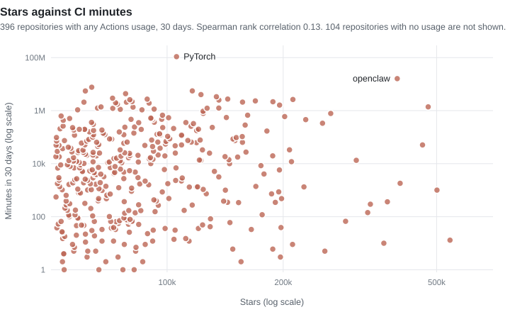
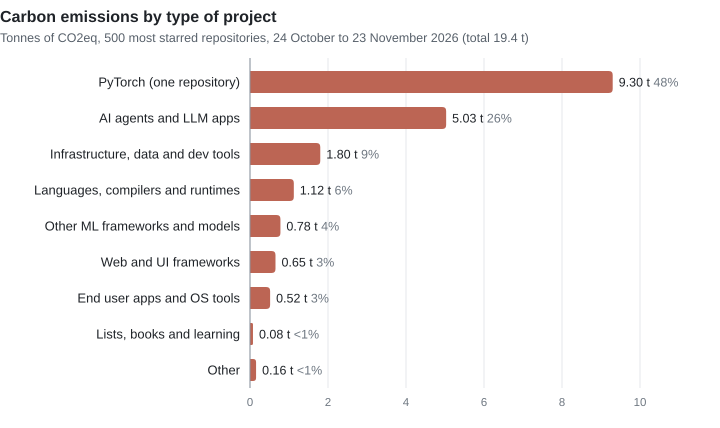

Every pull request and every commit on a popular open source project triggers automated builds and tests on GitHub Actions, and those run on servers that use electricity. We wanted to know how much, and which projects are behind most of it, so we looked at the Actions usage of the 500 most starred repositories over the 30 days from 24 October to 23 November 2026. Together they used 228 million minutes, which comes to about 51 MWh of electricity and 19 tonnes of CO2eq.
{: .post_intro}

[Aspen](https://github.com/DigitalPebble/aspen) is our open source tool for estimating the energy, carbon emissions and water use of GitHub Actions. It normally works from the jobs of your workflow runs or from your GitHub billing report, which tell it the runner type behind every minute. To cover 500 repositories we took the total minutes that GitHub shows on the Actions usage metrics page of each public repository, split by operating system, and applied Aspen's methodology to them.

Each minute is given the power draw of a standard GitHub hosted runner for its operating system. Energy comes from [BoaviztAPI](https://github.com/Boavizta/boaviztapi), multiplied by Microsoft's reported PUE of 1.16 for its American data centres, and carbon from the 2025 average US grid intensity published by [Ember](https://ember-energy.org), 384 g CO2eq per kWh. Water adds 0.34 litres per kWh for data centre cooling, the figure [Microsoft reports](https://datacenters.microsoft.com/sustainability/efficiency/) for the Americas, and 3.58 litres per kWh consumed by the power plants that generate the electricity, an average of [WRI](https://www.wri.org/data/dataset-guidance-calculating-water-use-embedded-purchased-electricity) factors for US regions. The result is a rough estimate. We have rounded it to two significant figures and have not tried to quantify its uncertainty.

## The ten repositories with the most minutes

| Repository | Rank by stars | Stars | Minutes | Energy (kWh) | Carbon (kg CO2eq) | Water (L) |
|---|---:|---:|---:|---:|---:|---:|
| [pytorch/pytorch](https://github.com/pytorch/pytorch) | 129 | 105,798 | 108,794,757 | 24,000 | 9,300 | 95,000 |
| [openclaw/openclaw](https://github.com/openclaw/openclaw) | 7 | 395,094 | 16,117,899 | 3,600 | 1,400 | 14,000 |
| [BerriAI/litellm](https://github.com/BerriAI/litellm) | 358 | 63,773 | 7,657,523 | 1,700 | 660 | 6,700 |
| [paperclipai/paperclip](https://github.com/paperclipai/paperclip) | 112 | 116,238 | 5,553,784 | 1,200 | 480 | 4,800 |
| [twentyhq/twenty](https://github.com/twentyhq/twenty) | 378 | 61,371 | 5,528,447 | 1,200 | 470 | 4,800 |
| [grafana/grafana](https://github.com/grafana/grafana) | 243 | 78,051 | 4,370,510 | 970 | 370 | 3,800 |
| [rust-lang/rust](https://github.com/rust-lang/rust) | 99 | 122,416 | 4,020,399 | 890 | 340 | 3,500 |
| [stablyai/orca](https://github.com/stablyai/orca) | 85 | 134,250 | 3,344,458 | 760 | 290 | 3,000 |
| [protocolbuffers/protobuf](https://github.com/protocolbuffers/protobuf) | 291 | 72,193 | 2,952,116 | 640 | 250 | 2,500 |
| [vercel/next.js](https://github.com/vercel/next.js) | 75 | 143,601 | 2,728,011 | 610 | 230 | 2,400 |
| **Total, all 500 repositories checked** |  |  | **228,046,320** | **51,000** | **19,000** | **200,000** |
{: .table}

Minutes are counted by GitHub. Energy, carbon and water are estimates, rounded to two significant figures.

## Stars say almost nothing about CI

The ten most starred repositories are mostly lists and learning material, such as [build-your-own-x](https://github.com/codecrafters-io/build-your-own-x), [awesome](https://github.com/sindresorhus/awesome), [public-apis](https://github.com/public-apis/public-apis) and [system-design-primer](https://github.com/donnemartin/system-design-primer). They have hundreds of thousands of stars and almost no CI, because there is little to build or test. Of the 500 repositories, 104 ran no Actions at all. Across the other 396, the Spearman rank correlation between stars and minutes is 0.13, which is close to no relation. On the chart below they form a flat cloud, with a few repositories far above it.

{: .img-post style="width: 720px; max-width: 100%"}

The repositories with the most minutes sit at ranks 129, 7, 358, 112 and 378 by stars. Stars measure attention. CI minutes follow how often the code changes, how many platforms it is tested on and how heavy the workflows are. The 100 lists, books and learning resources in the top 500 together account for 0.4% of the minutes.

## A handful of repositories use most of the minutes

[PyTorch](https://github.com/pytorch/pytorch) ran 108.8 million minutes in the month, 47.7% of the total, which is about 2,500 runners busy around the clock. Without it the concentration is still strong. Among the other repositories, the top 20 account for 65% of the minutes and the 34 above one million minutes for 81%. The mean repository with any usage ran about 300,000 minutes while the median ran about 7,200, a ratio of roughly 40.

PyTorch's real footprint is probably different from our figure. It used about 31,900 minutes for each pull request opened in the month, against a median of about 90 for the other repositories. Much of its CI may run on infrastructure the project manages itself, including GPU machines that use more energy per minute than the standard runner we assumed. Those machines may also sit in a region with cleaner electricity than the US average we applied. Carbon scales linearly with the power drawn per minute and with the carbon intensity of the grid, so a machine drawing twice as much on a grid half as carbon intensive gives the same figure as ours.

## Which kinds of project use the most minutes

To group the repositories by type, we fetched the topics and description of each and sorted them into eight categories, then checked the 50 repositories with the most minutes by hand. Those 50 repositories account for 94% of the total.

{: .img-post style="width: 720px; max-width: 100%"}

PyTorch is shown on its own because it would otherwise make machine learning frameworks look like the largest category by far. AI agents and LLM applications come next at 5.0 tonnes, about half of the emissions outside PyTorch.

| Category | Repositories | Minutes | Share of all minutes | Median minutes |
|---|---:|---:|---:|---:|
| PyTorch | 1 | 108.8M | 47.7% | n/a |
| AI agents and LLM apps | 147 | 59.0M | 25.9% | 10,027 |
| Infrastructure, data and developer tools | 55 | 21.0M | 9.2% | 5,449 |
| Languages, compilers and runtimes | 31 | 13.4M | 5.9% | 51,285 |
| Other ML frameworks and models | 34 | 9.2M | 4.0% | 4,464 |
| Web and UI frameworks | 59 | 8.0M | 3.5% | 8,417 |
| End user apps and OS tools | 21 | 5.9M | 2.6% | 1,763 |
| Lists, books and learning | 100 | 0.9M | 0.4% | 12 |
| Other | 52 | 1.8M | 0.8% | 24 |
{: .table}

Medians include the repositories that ran no Actions.

Languages, compilers and runtimes have a modest total, but the median project in that group runs over 50,000 minutes, five times the figure for AI agents. [Rust](https://github.com/rust-lang/rust), [CPython](https://github.com/python/cpython), [Node.js](https://github.com/nodejs/node) and [Protocol Buffers](https://github.com/protocolbuffers/protobuf) test every change on many platforms and versions, so their load is large and steady.

## Young AI projects and the pull requests behind their CI

Newer repositories do not run more CI across the board. Outside AI, the 21 repositories with any CI created since 2025 have a median of 790 minutes, against 5,100 for the 246 older ones. Among AI agent and LLM projects the pattern is the opposite, with a median of 17,800 minutes for the 75 created since 2025 and 10,200 for the 53 older ones. Averages show a much bigger gap, but a few projects pull them up. [openclaw](https://github.com/openclaw/openclaw), created on 24 November 2025, had 17,500 pull requests opened in the month, about 580 a day, and [Orca](https://github.com/stablyai/orca) had 11,000. Together they account for about a third of all the pull requests the young AI projects received.

The cost of a pull request does not explain the gap. The median repository runs about 90 minutes of CI for each pull request opened, and young AI projects are close to that with 98 minutes, against 88 for older AI projects. This is a rough ratio, since CI also runs on pushes and on schedules. The median young AI project does not receive many more pull requests than an older one either, 203 against 230 in the month. The gap comes from a handful of very busy projects. Coding agents opening many of those pull requests is one possible explanation, but the data does not say who opens them.

## How far to trust these figures

These are rough estimates, for five reasons.

- **Public repositories only.** Private repositories, which we cannot see, add to the total.
- **Every minute is treated as a standard GitHub hosted runner.** We know the split between Linux (89%), Windows (7%) and macOS (4%) but not the machine sizes. Self-hosted runners and larger machines can move a project's footprint up or down, depending on the machines and where they run. PyTorch is the obvious case, and any other project using its own runners is affected too.
- **The grid and water factors are US averages.** Runners in a region with cleaner electricity would emit less, and a litre of water counts the same in a dry region as in a wet one.
- **Embodied emissions are not included.** We count the electricity used while the runners are busy, not the emissions from manufacturing the servers.
- **The categories come from keyword rules,** checked by hand for the 50 repositories with the most minutes.

## Measure your own

CI footprint concentrates in a few projects, and how popular or large a project is does not tell you which ones.

[{: .img-post style="width: 120px; max-width: 100%"}](https://github.com/DigitalPebble/aspen)

[Aspen](https://github.com/DigitalPebble/aspen) measures it for your own repositories, as a GitHub Action or from your organisation's billing report. It is open source and the methodology is documented in the repository.

If you maintain one of the projects above and would like a more accurate picture, or want help reducing your CI footprint, get in touch. We are happy to talk it through.
